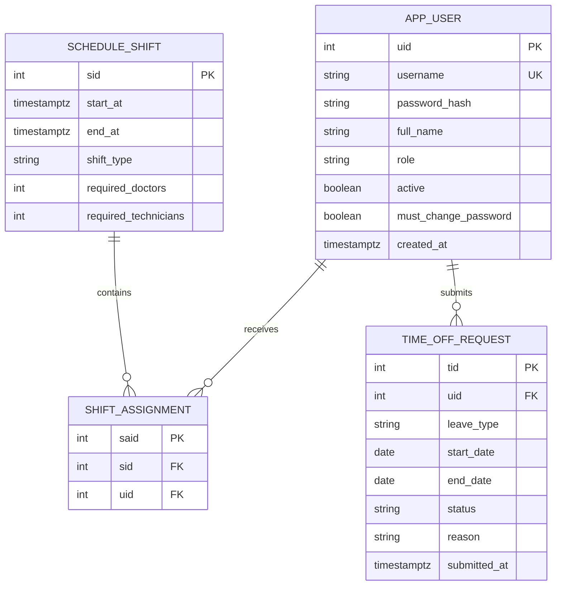

# Entity Relationship Diagram

The corresponding PostgreSQL table definitions and constraints are maintained in
[`../backend/src/main/resources/schema.sql`](../backend/src/main/resources/schema.sql).
